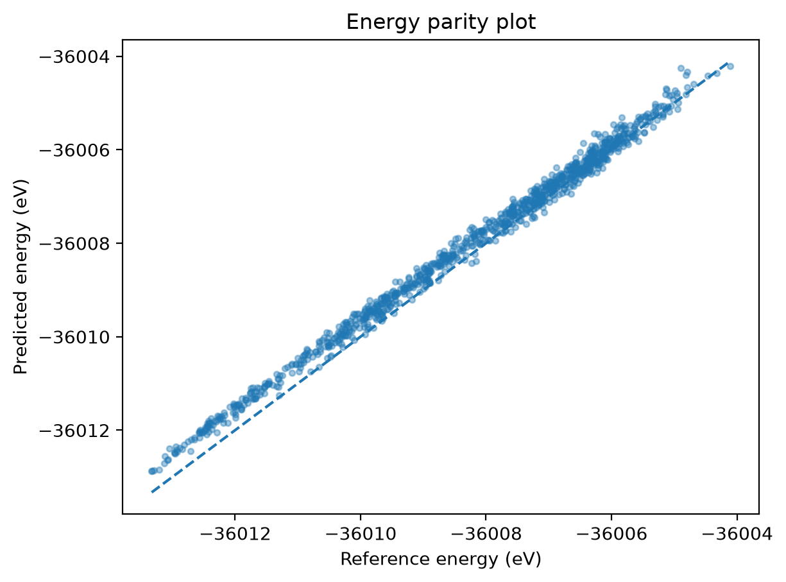

# Evaluating a DeePMD potential for reline

A CPU-based evaluation of the published `model.000.pb` potential from Shayestehpour and Zahn, using their reference energies and forces for reline: choline chloride and urea in a 1:2 molar ratio.

The question guiding this project is: **Can I reproduce the model's energy and force predictions, understand its errors, and check the symmetry properties described in Section 2.1 of the paper?**

This repository contains the inspection, evaluation, and plotting scripts developed during that process. The reference data and trained potential were produced by the original authors. This project evaluates their existing model; it does not retrain it or reproduce the paper's molecular dynamics simulations.

## Results

All **1000 configurations** in `data/raw/data/valid/set.000` were evaluated. Each contains **304 atoms**: eight choline cations, eight chloride anions, and sixteen urea molecules.

| Metric | Result |
| --- | ---: |
| Energy RMSE per atom | 1.019158 meV/atom |
| Mean signed energy error | +0.796247 meV/atom |
| Overall force-component RMSE | 0.049263 eV/Å |

Signed energy error means "**predicted minus reference**". For each frame the total-energy difference in eV is multiplied by 1000 and divided by 304 to obtain meV/atom. Energy RMSE is the square root of the mean squared error across frames.

Force-component RMSE includes every Cartesian force component of every atom. The overall value is calculated as the square root of the mean squared per-frame RMSE, which gives the pooled component RMSE because all frames have the same atom count.



Each point represents one configuration. The axes show reference and predicted energy; **frame number is not an axis or a colour scale**. The dashed line indicates perfect agreement.

Also see the [signed energy errors by frame](results/matplotlib_plot_1000_samples_model000_figure_energy_1.png) and [force-component RMSE by frame](results/matplotlib_plot_1000_samples_model000_figure_force_RMSE_1.png).

## Observations

The mean signed error is positive: that is, predicted energies are higher, or less negative, on average. More negative reference energies tend to have larger signed energy errors (for example, the most negative 25% of energies have a mean signed energy error of +1.380 meV/atom while the highest and least negative 25% have a mean signed energy error of +0.350 meV/atom). Higher reference energies tend to accompany larger force-component RMSE.

The plotting script calculates these descriptive Pearson correlations directly from the saved CSV:

| Variables | Pearson r |
| --- | ---: |
| Frame index / signed energy error | −0.624769 |
| Frame index / force-component RMSE | +0.663291 |
| Reference energy / signed energy error | −0.647324 |
| Reference energy / force-component RMSE | +0.716329 |
| Frame index / reference energy | +0.855261 |

Frame order is associated with both energies and errors. They do not establish how the configurations were ordered or which structural or thermodynamic conditions explain the patterns.


## Symmetry checks

The symmetry checks use validation frame 0 and compare transformed predictions with the original model predictions. Some obtained examples (results for the tested transformations):

| Transformation | Reported energy change (eV) | Largest force-component discrepancy (eV/Å) |
| --- | ---: | ---: |
| Translation by [0.3, −0.2, 0.4] Å | 0.000e+00 | 2.462e−13 |
| Atom-record permutation, seed 42 | 0.000e+00 | 8.549e−15 |
| Rotation by 37° about the z-axis (largest force-component difference after rotation) | 0.000e+00 | 3.090e−13 |

Coordinates and element types are permuted together. For rotation, both positions and simulation-cell vectors are rotated, and predicted forces are compared with the correspondingly rotated original forces. These numerical spot checks support energy invariance and force equivariance for the transformations tested.

## Reproduce the evaluation

Run commands from the project root: the directory containing this README and the Python scripts.

### 1. Environment

The recorded setup uses Linux x86-64, Python 3.11.16, NumPy 2.4.6, DeePMD-kit 3.2.0, TensorFlow CPU 2.21.0, and Matplotlib 3.11.2. The full Conda and pip package export is in `environment.yml`.

```bash
conda env create -f environment.yml
conda activate reline-md
```

The export contains Linux-specific dependencies and package versions, rather than an exact build lock for every platform. Recreation was verified by a separate test environment, which reproduced the expected frame 0 results.

### 2. Original data and model

Download `reline_mlp.zip` (approximately 1 GB) from [the authors' Zenodo record](https://doi.org/10.5281/zenodo.8275905). Extract it under `data/raw/`, placing the archive's `data`, `models`, and `inputs` directories directly inside `data/raw/`. Avoid an extra enclosing directory between `raw` and those directories.

The scripts expect:

| Path relative to the project root | Contents |
| --- | --- |
| `data/raw/data/valid/type_map.raw` | Element names in model type order |
| `data/raw/data/valid/type.raw` | Integer atom types |
| `data/raw/data/valid/set.000/` | `coord.npy`, `box.npy`, `energy.npy`, and `force.npy` |
| `data/raw/models/model.000.pb` | Original uncompressed trained model |

Training data, other models, and MD input scripts are not needed for this evaluation. The original archive, data, and models are excluded from Git through `.gitignore`; download them separately to run inference.

### 3. Inspect and evaluate

```bash
python inspect_frame_1.py
python evaluate_frame_1.py
python evaluate_frames.py
```

The first two scripts select **frame 0**. `evaluate_frames.py` evaluates frame 0, a reproducible sample of 50 unique frames (seed 42), the symmetry checks, and finally all 1000 validation frames. It creates and/or overwrites both result CSVs in `results/`.

Evaluation was performed on an Intel Core i7-1185G7 laptop with approximately 16 GB RAM (using the CPU). The 1000-frame evaluation loop took approximately 255 seconds in the recorded run; this excludes model loading and preceding checks. Runtime depends on hardware and runtime settings.

During CPU troubleshooting, `TF_ENABLE_ONEDNN_OPTS=0` was used to disable TensorFlow's oneDNN optimizations; the reported frame-0 predictions were unchanged at printed precision. This variable is not set inside the scripts and can be supplied before a command if needed:

```bash
TF_ENABLE_ONEDNN_OPTS=0 python evaluate_frame_1.py
```

### 4. Plot saved results

```bash
python matplotlib_plot_1000_samples_model000.py
```

This reads `results/validation_all_model000.csv`, saves three PNG figures, and prints the five correlations. Close each plot window to continue to the next plot and, finally, the printed correlations. The saved CSV and figures are included in the repository, so inspecting them or rerunning this plotting script does not require another model evaluation or a download of the original dataset.

The earlier `matplotlib_plot_50_samples_seed_42_model000.py` displays the corresponding three plots for the 50-frame sample. The figures were saved manually.

## Scope and follow-up

The authors' supplied validation set also appears under `validation_data` in their training configuration. These results therefore assess performance on that provided set, rather than on a newly collected independent test set. Agreement with the reference calculations does not by itself establish experimental accuracy or reliable transport properties, naturally.

Possible later additions include comparing models `001`to`003` and examining how energy errors relate to cell volume or structural descriptors. The first version focuses on model `000`, the saved validation results, and symmetry checks. If I manage to get some computational resources, a transfer learning project would be interesting (more details to come).

## Sources

- O. Shayestehpour and S. Zahn, *Efficient Molecular Dynamics Simulations of Deep Eutectic Solvents with First-Principles Accuracy Using Machine Learning Interatomic Potentials*. [Paper DOI: 10.1021/acs.jctc.3c00944](https://doi.org/10.1021/acs.jctc.3c00944).
- Original authors' data, models, and input scripts: [Zenodo DOI: 10.5281/zenodo.8275905](https://doi.org/10.5281/zenodo.8275905), version 1.
- [DeePMD-kit documentation](https://docs.deepmodeling.com/projects/deepmd/en/stable/) and [Conda environment documentation](https://docs.conda.io/projects/conda/en/stable/user-guide/tasks/manage-environments.html).
